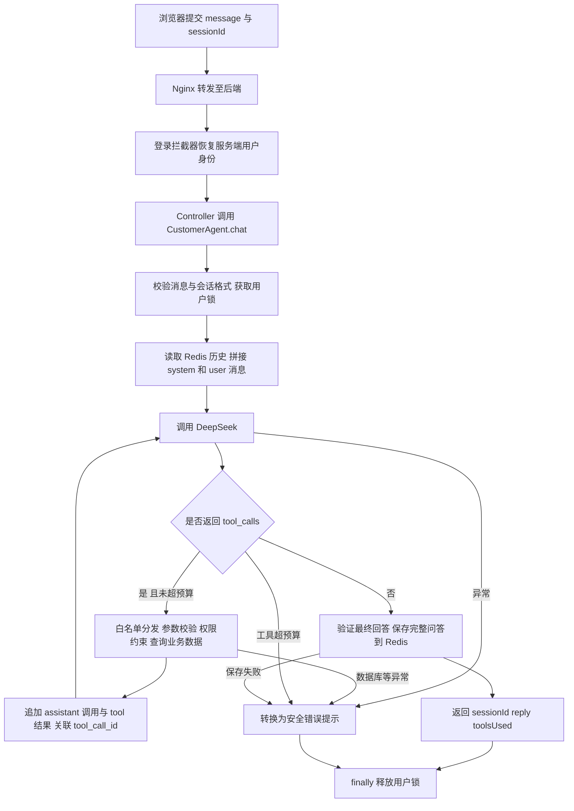

# 智能客服学习 TODO

创建日期：2026-10-14。目标：能画流程、能找到关键代码、能解释失败场景、能独立修改一个需求。复选框表示**你是否完成学习验收**，不表示该功能是否已开发；以下练习未替你完成。

## 0. 先确认项目边界

已实现：DeepSeek 工具调用、多轮对话、Redis 短期记忆、订单权限校验、有限工具循环、同用户并发互斥。

尚未实现：向量 RAG、人工工单、长任务恢复。Redis 对话历史不是工作流检查点，Redisson watchdog 不是进程崩溃后的任务恢复。调用次数上限不是每分钟限流或日预算。

- [ ] 用自己的话说明普通聊天、工具调用 Agent、固定工作流的区别。
- [ ] 说明当前 FAQ 是静态工具返回值，不是向量 RAG；模型不直接访问数据库。
- [ ] 准确说出边界：最多 3 轮工具、每轮至多 4 个工具、最多 4 次模型请求；第 4 次禁用工具；历史至多 6 个问答轮次，TTL 30 分钟。

## 1. 能画流程

先参考下面的图，再关闭文档自己画一遍。重点解释每个箭头传递的内容。



- [ ] 不看图，画出正常回答与工具调用的两条路径。
- [ ] 在图上标出 userId 的来源：请求 Token → Redis 登录态 → UserHolder，不能由模型指定。
- [ ] 画出第二轮请求如何复用 sessionId 和 Redis 历史。
- [ ] 补画未登录、锁竞争、参数无效这些提前结束的路径：未获得锁的请求不执行 unlock。
- [ ] 用一组 JSON 消息展示 user → assistant.tool_calls → tool.tool_call_id → assistant.content 的完整协议。

验收：用 3 分钟讲清一次“帮我查订单”的请求，能解释为什么通常需要两次模型调用。

## 2. 能找到关键代码

每项都要打开文件、定位方法，并写一句“输入、输出、负责什么”。不要只背类名。

| 找什么 | 代码入口 | 必须解释的点 |
|---|---|---|
| 页面提交 | [customer-service.html](../frontend/hmdp/customer-service.html)，send | /customer-agent/chat、sessionId、Token、单独的请求超时 |
| 请求鉴权 | [MvcConfig](../src/main/java/com/hmdp/config/MvcConfig.java)、[RefreshTokenInterceptor](../src/main/java/com/hmdp/utils/RefreshTokenInterceptor.java)、[LoginInterceptor](../src/main/java/com/hmdp/utils/LoginInterceptor.java) | Token 恢复身份，ThreadLocal 清理 |
| HTTP 入口 | [CustomerAgentController](../src/main/java/com/hmdp/controller/CustomerAgentController.java)，chat | 从 UserHolder 获取用户，不接收客户端 userId 授权 |
| Agent 主循环 | [CustomerAgent](../src/main/java/com/hmdp/agent/CustomerAgent.java)，chat | 轮数、工具预算、停止条件、finally |
| 会话记忆 | 同一方法中的 agent:history 与 history.size | userId+sessionId 隔离、TTL、只保存完成轮次 |
| 工具协议 | [CustomerTools](../src/main/java/com/hmdp/agent/CustomerTools.java)，definitions、tool | schema 是说明，执行仍需后端验证 |
| 工具执行 | 同一类 execute、text | 白名单、长度格式、查询上限 |
| 订单权限 | execute 中 get_my_order 分支 | SQL 的 user_id 条件；越权与不存在返回相同结果 |
| 模型调用 | [DeepSeekClient](../src/main/java/com/hmdp/agent/DeepSeekClient.java)，complete | Bearer、messages/tools、tool_choice、网络超时 |
| 安全错误 | DeepSeekClient 的 catch 与 [AgentUnavailableException](../src/main/java/com/hmdp/agent/AgentUnavailableException.java) | 不暴露上游错误正文或密钥 |
| 回归测试 | [CustomerAgentTest](../src/test/java/com/hmdp/agent/CustomerAgentTest.java)、[DeepSeekClientTest](../src/test/java/com/hmdp/agent/DeepSeekClientTest.java) | Mock 验证可控失败与边界 |
| 真实联调 | [RealCustomerAgentTest](../src/test/java/com/hmdp/RealCustomerAgentTest.java) | 显式启用，会产生真实 API 费用 |

- [ ] 按表定位全部代码，记录每个关键判断的原因。
- [ ] 在调试器中跟一次 get_faq，观察 messages 的结构变化；不记录密钥和私人订单全文。
- [ ] 找到 2000 字符输入上限、1000 输出 Token 上限、12000 字符回答检查，解释它们不能互相替代。
- [ ] 解释为什么保存历史时不保存 system 提示和每次工具结果。

验收：随机问你“为什么不能查看别人的订单”或“模型一直查工具怎么办”，你能在 1 分钟内定位相关判断和测试。

## 3. 能解释失败场景

针对每行，用“触发条件 → 当前行为 → 用户看到什么 → 如何验证/改进”讲一遍。模拟优先用 Mock，不要为了测试故障删除真实业务数据。

| 场景 | 当前行为 | 要说明的限制 |
|---|---|---|
| 未登录/Token失效 | 拦截器返回401，前端跳登录 | 请求未进入 Agent |
| 同用户并发提问 | tryLock失败，提示稍后重试 | 同用户跨会话也互斥，但连续请求仍可消耗费用 |
| 模型传错参数或未知工具 | 返回工具参数错误/不支持的工具给模型 | 不执行任意函数；数据库故障则可能终止整轮 |
| 伪造userId/查询他人订单 | 查询附加服务端用户ID，返回不存在或无权 | 提示词不是权限边界，后端SQL才是 |
| 模型反复调用工具 | 达到上限后禁用工具，违规继续调用则失败 | 最大12次工具执行，不等于12次模型请求 |
| 密钥错误/余额不足/429 | 返回对应的安全提示 | 不自动无限重试，不暴露上游正文 |
| 连接或读取超时 | 返回网络提示，本轮不保存 | 已发生的API调用可能仍计费；单请求超时不是全局deadline |
| Redis读取失败 | 无法取历史，整轮失败并释放锁 | 没有自动退化成无记忆对话 |
| 模型答完，Redis写入失败 | 不能正常返回成功，本轮历史未保证保存 | 模型调用可能已计费，重试可能再次调用 |
| 历史保存后浏览器断网 | 服务端可能已成功，用户却没收到 | 没有请求幂等键，重发可能重复问答、重复计费 |
| 历史过期/超过6轮 | 旧上下文不再传给模型 | 模型不是永久记忆，历史答案也不是实时订单状态 |
| Java进程在工具执行中退出 | 下次请求只能读取已保存的旧问答 | 不恢复执行到一半的Agent循环；没有持久化步骤状态 |
| 用户或商户文本含恶意指令 | 提示词要求按数据处理；后端限制工具和权限 | 无法保证模型永不受影响，仍需攻击样本评测 |

- [ ] 运行已有隔离测试，逐项对应上述场景。
- [ ] 自己补一个有意义的失败测试，例如“Redis写入失败时释放锁，且不返回成功”。
- [ ] 解释恢复对话与恢复任务的区别；指出当前代码缺少任务ID、步骤状态、幂等执行记录等。

```powershell
mvn -Dtest=CustomerAgentTest,DeepSeekClientTest test
```

验收：不用泛泛地说“加重试”，能回答是否可重试、会不会重复执行、会不会重复扣费，以及用户如何知道结果。

## 4. 能自己修改一个需求

推荐练习：**新增只读工具 get_shop_detail，让用户按商户ID查询营业时间、地址和均价。** 本次只建立练习，未替你实现它。

- [ ] 先写需求与边界：只查公开字段；不存在时说明；不返回未确认的信息；商户ID为正整数字符串。
- [ ] 在 CustomerTools.definitions 注册工具名称、描述和 shopId 参数，说明描述如何帮助模型选择工具。
- [ ] 在 execute 新增白名单分支；独立校验数值格式和Long范围；按ID查询公开字段。
- [ ] 测试正常商户、不存在、空参数、非法ID、数值溢出；断言返回字段范围。
- [ ] 用Mock模型验证先选择新工具、回填tool结果、再返回回答的链路，而不是仅验证字符串拼接。
- [ ] 手工测试“商户1几点开门”，核对 toolsUsed 和数据库；不把模型自由措辞写成必须逐字匹配的断言。
- [ ] 用已有多轮对话追问“它在哪里”，说明模型如何使用上一轮的商户ID，以及何时必须重新查工具。
- [ ] 更新客服README，写明新增行为、测试结果和边界，再向别人演示。

验收：能独立完成“注册 → 校验 → 执行 → 回传 → 生成回答 → 测试”，修改前先说明是否需要动Controller、主循环和前端，不机械地改所有层。

完成上述练习后任选一项进阶，不必同时做：把历史轮数/TTL配置化；增加请求幂等键；添加用户速率限制。每个需求都要先给出验收条件和失败路径。

## 5. 尚未实现的扩展：先设计，再开发

- [ ] 向量RAG：画出资料导入、切分、Embedding、召回、回答引用流程；说明无命中、过期文档、错误召回、文档权限如何处理。产出一页设计，不先引入向量库。
- [ ] 人工工单：设计用户发起、用户确认、创建工单、查询状态、人工回复；考虑数据表、用户隔离和重复创建。客服不能口头说“已转人工”而没有真实记录。
- [ ] 长任务恢复：设计持久化任务ID、步骤状态、检查点、幂等工具、失败重试与恢复入口；演示进程重启后从哪里恢复。聊天历史不能代替这些记录。

这些复选框是后续设计学习项，不表示项目已具备对应能力。

## 最终面试验收

- [ ] 不看稿，5分钟画图并讲完一次客服请求。
- [ ] 现场打开代码解释工具权限、会话隔离、调用预算。
- [ ] 随机解释3个失败场景，区分已处理与未处理的风险。
- [ ] 展示自己完成的新工具需求、测试和修改说明。
- [ ] 明确说出向量RAG、人工工单、长任务恢复仍未实现，不夸大为全自动售后系统。

建议学习顺序：边界 → 流程 → 代码 → 失败测试 → 独立需求 → 扩展设计。每完成一项再将`[ ]`改为`[x]`。
